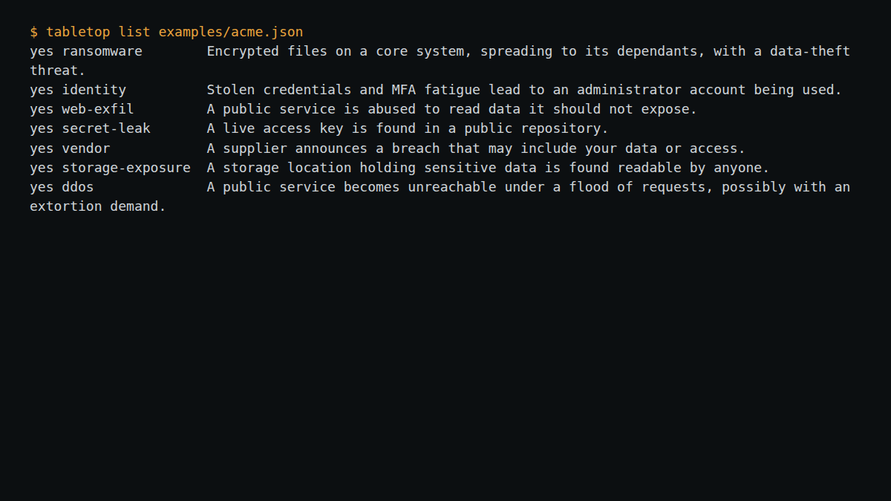

# tabletop

Generate an incident-response tabletop exercise from a short JSON description of your own systems. The output is a single offline HTML facilitator page (or Markdown / JSON): injects revealed one at a time, questions to ask, notes and decision boxes, an exercise clock, a gap-and-owner list, and a downloadable after-action review. Python 3.9+, no dependencies, no network.

```bash
tabletop list examples/acme.json                                       # which scenarios fit your model
tabletop generate examples/acme.json --scenario ransomware -o ransomware.html
tabletop generate examples/acme.json --scenario identity --format md -o identity.md   # printable
```

Scenarios: ransomware, identity-provider compromise, exploited internet-facing service, leaked credential, supplier compromise, public storage exposure, traffic flood. Each has 4–5 injects and questions about decision authority, communication and evidence.

## What is model-specific

Your `assets` (kind, data classes held, dependencies, internet-facing), `roles`, and `controls` change the output: injects name your real systems and data and their dependants; the scenario is applied only if your model has something it can happen to; and extra questions appear depending on controls you list or omit (for example "your model lists no immutable backups: what is the fallback?"). See `examples/acme.json` (fictional).

## The facilitator page

Works offline from a file. Start/pause clock, "Reveal next inject" (moves focus to the new inject), notes and decision fields per inject, a gaps table with owners and due dates, theme toggle, print stylesheet (prints all injects), and "Download review (Markdown)", and an **after-action summary** that updates as you type. The summary counts what was written down: injects revealed, injects with a decision recorded (and which have none), gaps with no owner or no due date, gaps per owner, and a per-inject table of planned time against the time it was revealed and how long the room spent on it (from the exercise clock; "not timed" if the clock was not running). It is also the first section of the downloaded review. It does not score the team or judge the answers. Notes are saved in this browser's local storage so a reload does not lose them: **they stay on that machine until you press "Clear saved notes"**. Nothing is transmitted. Animation is a 150 ms fade, disabled under reduced-motion.

## Limits

- Scenario text is generic practice written for this tool, not reviewed by an incident-response professional, and not mapped to ATT&CK or any standard. Edit `src/tabletop/catalog.json` freely. See [docs/RESEARCH.md](docs/RESEARCH.md).
- It does not simulate tools, score teams, or infer attack paths.
- Not yet used in a real exercise.

## Roadmap

Not done yet, in rough order of value:

- Have the scenario catalog reviewed by an actual incident-response professional, and optionally map injects to MITRE ATT&CK.
- Run it in a real tabletop exercise and fold back what did and did not work.
- Per-participant timing (the page times each inject, not each person).

## Development

`python -m unittest discover -s tests` (20 tests; 8 of them drive the generated page in headless Chrome through Playwright, including a fake clock for the timing, and are skipped if Playwright or a browser is missing; `TABLETOP_CHROME` points at a browser). The generated page was checked in headless Chromium: reveal, notes, gaps, clock, export, reload persistence, axe-core 0 violations and no horizontal overflow at 1280px and 390px in both themes, re-run on 2026-11-01 with the summary populated (automated checks only).

Not yet independently reviewed; the tests and documented limits describe what has been checked. MIT licence.

Designed and built by Maak — https://github.com/0xM44k

## Evidence



The image above is a capture of the command shown at the top of the image, run against the files in this repository on 2026-10-28. It is the tool's actual output, rendered in a terminal panel for legibility; no output lines were invented.
